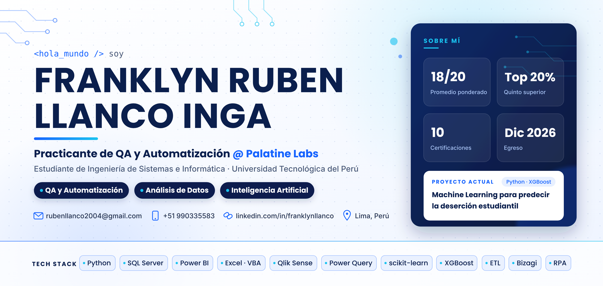

# ¡Hola! Soy Franklyn Llanco 👋

   
---

## 🧑‍💻 Sobre mí

Estudiante de décimo y último ciclo de **Ingeniería de Sistemas e Informática** en la Universidad Tecnológica del Perú (UTP), con egreso en diciembre de 2026 y perteneciente al **quinto superior**.

Actualmente realizo mis prácticas preprofesionales como **QA y Automatización en Palatine Labs**, una empresa de automatización de procesos (RPA). Ahí desarrollo automatizaciones en la plataforma Palatine, ejecuto casos de prueba, reporto y hago seguimiento de incidencias junto al equipo de desarrollo, y documento los flujos.

Antes trabajé como **Asistente Administrativo** en el rubro ferretero. Ahí automaticé reportes de ventas en Excel con macros y VBA, y también di soporte técnico a los equipos de oficina.

En la universidad desarrollo un proyecto de **Machine Learning para predecir la deserción estudiantil**. Comparo Árbol de Decisión, Random Forest y XGBoost en Python y uso SMOTE para manejar el desbalance de clases.

Me interesan la automatización, el análisis de datos, la ciencia de datos y la Inteligencia Artificial. Uso IA generativa (Claude, ChatGPT) para programar, depurar código y documentar.

- 💼 **Rol actual:** Practicante de QA y Automatización – Palatine Labs
- 🎯 **Enfoque actual:** Automatización de procesos (RPA), QA y análisis de datos
- 📊 **Intereses:** Business Intelligence, SQL, Python, Machine Learning e IA
- 🧠 **Aprendiendo:** Ciencia de datos con Python e inglés (nivel A2, en progreso)
- 🎓 **Egreso:** Diciembre 2026

---

## 🛠️ Stack Tecnológico

| Área | Tecnologías |
|---|---|
| **Datos & BI** |     |
| **Lenguajes** |    |
| **Web** |   |
| **Procesos & Herramientas** |     |
| **Calidad** |   |

---

## 📌 Áreas de trabajo

**🧪 QA y Automatización de Procesos**
- Desarrollo de automatizaciones de procesos (RPA) en la plataforma Palatine según los requerimientos.
- Pruebas funcionales: ejecución de casos de prueba, validación de resultados y reporte de errores.
- Seguimiento de incidencias y verificación de correcciones junto al equipo de desarrollo.
- Documentación de las pruebas y de los flujos de automatización.

**📊 Análisis de Datos y Business Intelligence**
- Dashboards interactivos en Power BI (modelado de datos y DAX) y Qlik Sense.
- Limpieza y transformación de datos con Power Query y procesos ETL.
- Reportes en Excel avanzado con tablas dinámicas, macros y VBA para agilizar el procesamiento de información.

**🗄️ Bases de Datos**
- Diseño de bases de datos relacionales en SQL Server, modeladas con diagramas UML.
- Consultas avanzadas y procedimientos almacenados.

**🤖 Machine Learning e IA**
- Modelos supervisados en Python con pandas, scikit-learn, XGBoost e imbalanced-learn.
- Uso de IA generativa (Claude, ChatGPT) para programación, depuración y documentación.

**⚙️ Modelado de Procesos y Otros**
- Modelamiento de procesos de negocio con Bizagi (BPMN).
- Páginas web estáticas responsive con HTML y CSS.
- Configuración de routers y switches y simulación de redes LAN en Cisco Packet Tracer.

---

## 🚀 Proyectos destacados

### 🎓 [Machine Learning para la predicción de deserción estudiantil universitaria](https://github.com/Franklyn2349/prediccion-desercion-estudiantil-ml)
*Taller de Investigación – Universidad Tecnológica del Perú (2026)*

> Proyecto de investigación que busca identificar a tiempo a los estudiantes con riesgo de abandonar sus estudios, para apoyar la toma de decisiones de las universidades.

🤝 **Desarrollado en colaboración con:** Edgar Piero López Bernal · [LinkedIn](https://www.linkedin.com/in/edgarpierolopezbernal) · [GitHub](https://github.com/Shidowar)

🔗 **Repositorio:** [Franklyn2349/prediccion-desercion-estudiantil-ml](https://github.com/Franklyn2349/prediccion-desercion-estudiantil-ml)

**¿Qué se hizo?**
- Se compararon tres algoritmos de aprendizaje supervisado: **Árbol de Decisión**, **Random Forest** y **XGBoost**.
- Se evaluaron **dos escenarios temporales** para ver qué tan pronto se puede predecir la deserción.
- Se preprocesaron los datos y se manejó el **desbalance de clases con SMOTE** dentro de pipelines, para evitar fuga de datos.
- Los modelos se evaluaron con la métrica **F1-macro**, adecuada para clases desbalanceadas.

**Dataset:** dataset público de **4,424 registros** del UCI Machine Learning Repository.

**Tecnologías:** Python · pandas · scikit-learn · XGBoost · imbalanced-learn

🤖 **Uso de IA:** el desarrollo fue asistido por herramientas de IA generativa (Claude, ChatGPT) como apoyo en la programación, depuración y documentación. El diseño metodológico y la interpretación de los resultados son de los autores.

---

## 📫 Contacto

- 📍 Lima, Perú 🇵🇪
- 📞 +51 990335583
- 💼 [Franklyn Llanco](https://www.linkedin.com/in/franklynllanco)
- 📄 [Ver mi CV](https://github.com/Franklyn2349/Franklyn2349/blob/main/CV_Franklyn_Llanco_Inga.pdf)
- ✉️ rubenllanco2004@gmail.com
