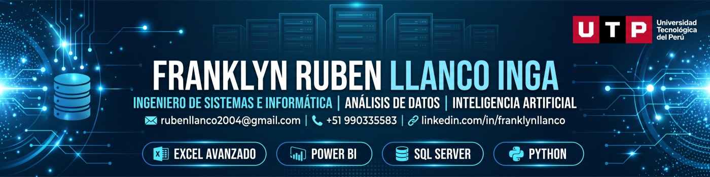

[README.md](https://github.com/user-attachments/files/34396615/README.md)
# ¡Hola! Soy Franklyn Llanco 👋

   
---

## 🧑‍💻 Sobre mí

Estudiante de décimo y último ciclo de **Ingeniería de Sistemas e Informática** en la Universidad Tecnológica del Perú (UTP), con egreso en diciembre de 2026 y perteneciente al **quinto superior**.

Actualmente realizo mis prácticas preprofesionales como **QA y Automatización en Palatine Labs**, una empresa de automatización de procesos (RPA). Ahí desarrollo automatizaciones en la plataforma Palatine, ejecuto casos de prueba, reporto y hago seguimiento de incidencias junto al equipo de desarrollo, y documento los flujos.

Antes trabajé como **Asistente Administrativo** en el rubro ferretero. Ahí automaticé reportes de ventas en Excel con macros y VBA, y también di soporte técnico a los equipos de oficina.

En la universidad desarrollo un proyecto de **Machine Learning para predecir la deserción estudiantil**. Comparo Árbol de Decisión, Random Forest y XGBoost en Python y uso SMOTE para manejar el desbalance de clases.

Me interesan la automatización, el análisis de datos, la ciencia de datos y la Inteligencia Artificial. Uso IA generativa (Claude, ChatGPT) para programar, depurar código y documentar.

- 💼 **Rol actual:** Practicante de QA y Automatización – Palatine Labs
- 🎯 **Enfoque actual:** Automatización de procesos (RPA), QA y análisis de datos
- 📊 **Intereses:** Business Intelligence, SQL, Python, Machine Learning e IA
- 🧠 **Aprendiendo:** Ciencia de datos con Python e inglés (nivel A2, en progreso)
- 🎓 **Egreso:** Diciembre 2026

---

## 🛠️ Stack Tecnológico

| Área | Tecnologías |
|---|---|
| **Datos & BI** |     |
| **Lenguajes** |    |
| **Web** |   |
| **Procesos & Herramientas** |     |
| **Calidad** |   |

---

## 📌 Áreas de trabajo

**Análisis de Datos y BI**
- Dashboards en Power BI y Qlik Sense
- Consultas y modelado de bases de datos en SQL Server
- Procesos ETL

**Automatización**
- Macros y programación VBA en Excel
- Automatización de pruebas (QA)

**Modelado y Procesos**
- Diagramas UML y modelado de bases de datos
- Modelamiento de procesos con Bizagi

---

## 🚀 Proyectos destacados

> Proyectos desarrollados durante mi formación universitaria.

- **Predicción de deserción estudiantil (Machine Learning):** proyecto de investigación con Python. <!-- agrega el link al repo -->

---

## 📫 Contacto

- 📍 Lima, Perú 🇵🇪
- 📞 +51 990335583
- 💼 [LinkedIn](www.linkedin.com/in/franklynllanco)
- ✉️ rubenllanco2004@gmail.com
